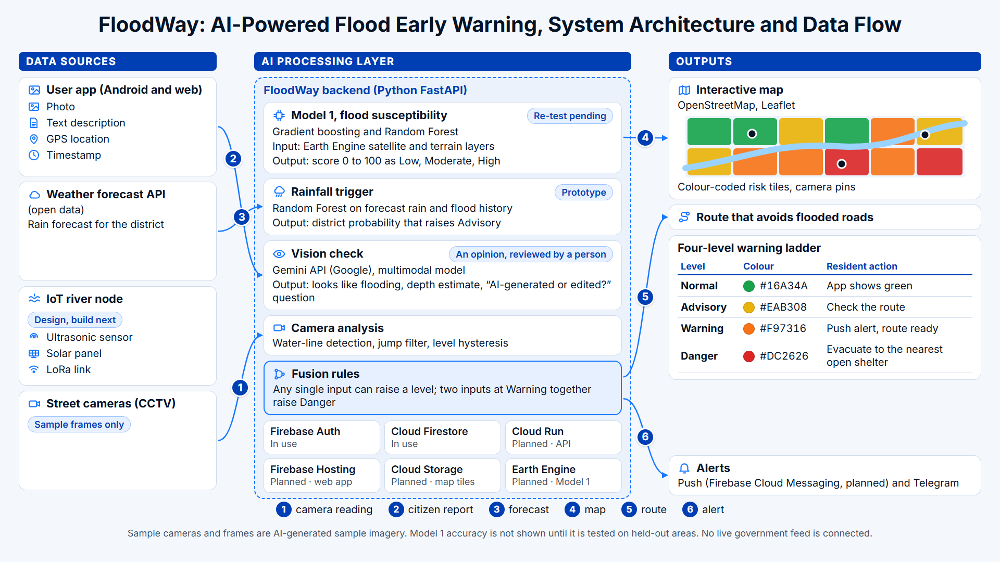

# FloodWay: flood early warning for Malaysian townships
### Sime Darby Property University Hackathon 2026 · Township of Tomorrow

> **"One glance to know if you are safe. One tap to find shelter."**

FloodWay warns residents of flood-prone places before the water reaches them. It turns four inputs into one four-level warning (Normal, Advisory, Warning, Danger), shows it on a map, routes people around flooded roads to an open relief centre, and sends alerts.

**What is real today:** the camera water-level pipeline, photo upload, alert logic, the sensor fault filter, OpenStreetMap road routes, the Android app's offline cache and local notifications. **Simulated or sample:** the five cameras and their AI-generated frames, relief centres, flood-prone areas, reports, family members, underpass barriers and the forecast input. **Not built:** government camera feeds, agency verification, a real road barrier. Full table: `docs/ops/DEMO_RUNBOOK.md`.

---

## Architecture



| Input | What it answers | Status |
|---|---|---|
| Model 1, flood susceptibility (GINKGO, `models/ginkgo/`) | *Where* water is likely to collect | Trained; re-test pending (`models/ginkgo/MODEL_CARD.md`) |
| Weather forecast and rainfall trigger | *When* heavy rain is coming | Prototype; the app uses a rule-based formula today |
| IoT river node (ultrasonic, solar, LoRa) | *How high* the river is now | Designed; firmware sketch in `firmware/` |
| Street cameras and citizen photos | *What* is happening on the road | Built and tested on sample frames; Gemini gives an opinion on photos |

A small set of readable rules combines them: any single input can raise a level; two inputs at Warning together raise Danger.

## Stack (Google ecosystem)

| Layer | Technology | Status |
|---|---|---|
| Web app | React 19, TypeScript, Vite, Tailwind CSS 4, Leaflet + OpenStreetMap | Running |
| Android app | Expo, React Native | Code done; no APK yet |
| Backend | Python, FastAPI, OpenCV | Running locally |
| Sign-in and data | Firebase Authentication, Cloud Firestore | In use |
| Photo check | Gemini API (OpenRouter as fallback) | Built; live call not yet run |
| Hosting | Cloud Run (API), Firebase Hosting (web), Cloud Storage (photos, map tiles) | Planned |
| Push alerts | Firebase Cloud Messaging, Telegram | Telegram works; FCM planned |
| Model 1 features | Google Earth Engine (Sentinel-2, Copernicus DEM) | Planned |

The plan and its order: `docs/plans/GLOBAL_STACK_PLAN.md`. Every algorithm, with its parameters and limits: `docs/architecture/FLOODWAY_OVERVIEW.md`.

## Repository

```
frontend/   React web app (pages, components, lib/ = pure rules shared with mobile)
backend/    FastAPI: vision/ (camera pipeline), routes/, services/ (rule-based forecast, Telegram)
mobile/     Android app (Expo)
models/     ginkgo/ (Model 1 classifiers), ml_pipeline/ (GRU forecaster, synthetic weights), legacy_ann/
firmware/   ESP32 depth node and bench barrier sketches
docs/       architecture/, plans/, ops/, ai/PROGRESS.md (status board)
```

## Quick start

```bash
# web app
cd frontend && npm install && npm run dev        # http://localhost:5173

# backend
cd backend
python -m venv .venv && .venv\Scripts\activate   # Windows
pip install -r requirements.txt
python run.py                                    # http://localhost:8080, API docs at /docs
```

All checks: `powershell -File scripts/check.ps1`. Copy `backend/.env.example` to `backend/.env` to set the Gemini key, Telegram token and write token. Never put a secret in a `VITE_` variable.

## Honesty rules

The sample cameras are AI-generated sample imagery. The demo forecast is a formula, not a trained model. No accuracy number is shown unless this repo can reproduce it. FloodWay is decision support; official warnings stay with the authorities.
